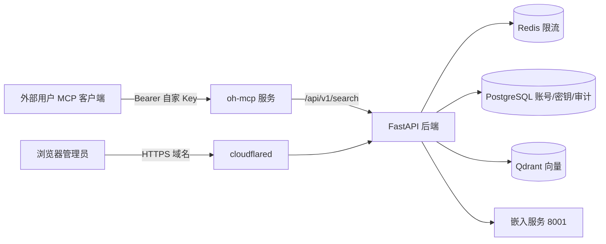

## 产品概述

把现有职业健康知识库从「本机自用检索系统」升级为「可对外提供的检索服务」：每个外部用户分配独立 API Key，用自己的大模型客户端（Claude Desktop / Cursor / Cline 等 MCP 客户端）通过 MCP 调用知识库检索，回答时附带文档名与页码，原文仍留在本机。

## 核心功能

- **MCP 检索服务**：暴露 `search_knowledge`、`get_chunk`、`list_documents`、`list_taxonomy` 四个工具，支持 stdio 与 HTTP 两种接入；只返回检索结果与引用，不生成答案
- **接入方与密钥管理**：新建接入方、签发密钥（明文只显示一次）、轮换、吊销、启停、单独设置每分钟限额
- **账号管理**：新建用户、修改角色与显示名、停用、重置密码，禁止移除最后一个管理员
- **限流与用量统计**：按接入方独立限流；统计调用量、成功率、平均与 P95 耗时、降级次数、最近使用时间
- **公网访问**：Cloudflare Tunnel 出站隧道，自动 HTTPS；前端构建产物由后端托管，外部用户只访问一个域名

## 界面效果

- 运营管理下新增「接入与账号」入口，包含接入方、账号、用量三块内容
- 表格化列表 + 行内操作按钮；新建密钥用弹窗展示并提供复制，关闭后不可再查看
- 用量统计用表格加纯 CSS 条形呈现，不引入图表库
- 与现有设计系统保持一致：同一套卡片、间距、状态标签与紧凑表格密度

## 技术栈

- 后端：FastAPI + SQLAlchemy + Alembic + PostgreSQL + Redis（沿用现状）
- MCP：官方 `mcp` Python SDK（FastMCP），`httpx` 转发后端接口
- 前端：React + TypeScript，复用现有 `components/ui.tsx` 与 `global.css`，不新增组件库与图表库
- 公网入口：`cloudflared` 出站隧道，后端仍只监听 127.0.0.1
- 迁移：新增 `0012_api_client_access`

## 实现方案

**1. 接入方与密钥（后端接口化）**
现有能力只在 CLI（`services/api_clients/cli.py`），需补 HTTP 管理层，复用 `ApiClientService` 与 `APIClient / APIKey` 模型（已含 `rate_limit_per_minute`、`scopes`、`status`、`expires_at`、`revoked_at`）：

| 接口 | 作用 |
| --- | --- |
| `GET /api/v1/api-clients` | 列表：名称、密钥前缀、状态、scopes、限额、最近使用、近 30 天调用量 |
| `POST /api/v1/api-clients` | 创建接入方并签发首个密钥，明文仅此一次返回 |
| `PATCH /api/v1/api-clients/{id}` | 改状态、scopes、限额、备注 |
| `POST /api/v1/api-clients/{id}/keys` | 轮换/新增密钥（旧密钥可保留过渡） |
| `DELETE /api/v1/api-clients/{id}/keys/{key_id}` | 吊销单个密钥 |
| `GET /api/v1/api-clients/{id}/usage` | 单接入方用量明细 |


密钥仍只存 `sha256`，创建与轮换是唯一返回明文的地方；CLI 保留，避免破坏既有脚本。

**2. 按接入方限流**
`RateLimitMiddleware` 现在统一用 `settings.rate_limit_per_minute`，且把原始 `Authorization` 当 Redis key（敏感数据落在 Redis 键里）。改为：

- `ApiClientService.authenticate()` 认证通过时，把该接入方的限额写入 Redis：`rl:cfg:<sha256前16位>`，TTL 600 秒
- 中间件取 Bearer → 哈希 → 读限额（读不到用默认值）→ 计数键用 `rl:<hash前16位>:<bucket>`，不再存明文
- Cookie 会话用户维持按 IP 限流，行为不变
- Redis 异常时放行，保持现有降级策略

**3. 用户管理**
新增 `users_admin` 路由，复用 `core/security.hash_password` 与 `User` 模型（已有 `role`、`status`、`locked_until`）：

- `GET/POST /api/v1/users`、`PATCH /api/v1/users/{id}`、`POST /api/v1/users/{id}/password`
- 约束：不能停用或降级自己；不能移除最后一个 `admin`；停用用户时吊销其全部 `Session`

**4. 用量统计**
`search_audits` 已带 `actor_id / actor_type / took_ms / degraded / created_at`，直接聚合，无需新表：

- `GET /api/v1/admin/usage?days=30&actor_type=api_client` 返回按接入方、按天的调用量、成功数、P95 耗时、降级次数
- SQL 用 `date_trunc('day')` + `percentile_cont(0.95)`；迁移 0012 增加 `(actor_id, created_at)` 复合索引，避免全表扫描

**5. MCP 服务**
新增 `backend/src/occupational_health/mcp/`，作为可选能力，不影响离线主流程：

- 工具只做检索与整形，禁止生成答案；单条片段截断约 1200 字，表格转 Markdown 并限制 40 行，附 `chunk_id / document_name / page_start / page_end`
- `--stdio` 从环境变量读 `OH_API_TOKEN`（供 Claude Desktop 本地接入）
- `--http --port 8765` 走 streamable HTTP，要求调用方每次携带 `Authorization: Bearer <自家 Key>`，服务端原样转发给后端，不集中保存密钥
- 后端不可达时返回结构化 `{error, message}`，不抛异常中断对话
- 依赖用可选组 `[project.optional-dependencies] mcp`，新增脚本入口 `oh-mcp`

**6. 公网托管与前端落地页**

- `main.py` 新增 `StaticFiles` 挂载 + SPA fallback：非 `/api/*` 路径回 `index.html`；仅在 `frontend/dist` 存在且 `OH_SERVE_FRONTEND=true` 时启用
- `run()` 的 host/port 改为读配置，新增 `proxy-headers` 与 `forwarded-allow-ips=127.0.0.1`，保证限流拿到真实来源
- `deploy/cloudflared/config.yml` 单条 ingress → `http://127.0.0.1:8000`；配套 `启动公网.bat` 负责 build 前端、起服务、起隧道
- 生产开关：`OH_ENV=production`、`OH_COOKIE_SECURE=true`（CF 提供 HTTPS）、`OH_ENABLE_DOCS=false` 关闭公网 OpenAPI 文档

## 架构



## 关键约束与取舍

- 生成在对方模型侧完成，我们只提供检索与引用，避免承担模型成本与内容合规责任
- 中间件不做数据库查询：限额通过 Redis 下发，避免每请求一次 DB 往返
- 密钥不可逆存储，前端不缓存明文；轮换而非原地改密，便于灰度过渡
- 不改造现有离线链路：管理员登录、上传、切分确认、检索全部保持原行为
- 文档出公网是既定前提，需在部署说明中提示合规边界

## 目录结构

```
backend/
├── src/occupational_health/
│   ├── api/routes/
│   │   ├── api_clients_admin.py   # [NEW] 接入方与密钥管理接口
│   │   ├── users_admin.py         # [NEW] 用户管理接口
│   │   └── usage_admin.py         # [NEW] 用量聚合接口
│   ├── services/api_clients/
│   │   └── service.py             # [MODIFY] 列表/改配/轮换/吊销/用量；认证时下发限额
│   ├── services/api_clients/rate_limit.py   # [MODIFY] 支持限额读写与哈希键
│   ├── api/middleware/rate_limit.py         # [MODIFY] 按接入方限额、键脱敏
│   ├── api/main.py                # [MODIFY] 挂载静态资源、SPA fallback、可配置 host/port、注册新路由
│   ├── core/config.py             # [MODIFY] serve_frontend/frontend_dist/api_host/api_port/mcp 相关配置
│   └── mcp/
│       ├── __init__.py            # [NEW]
│       └── server.py              # [NEW] FastMCP 四工具，stdio 与 HTTP 双传输
├── alembic/versions/0012_api_client_access.py  # [NEW] 复合索引 + 接入方备注字段
└── pyproject.toml                 # [MODIFY] optional-dependencies: mcp；scripts: oh-mcp

frontend/src/
├── services/access.ts             # [NEW] 接入方/账号/用量 API 封装
├── features/access/
│   ├── ApiClientManager.tsx       # [NEW] 列表、新建弹窗（一次性密钥+复制）、轮换、停用、限额
│   ├── UserManager.tsx            # [NEW] 用户列表、新建、改角色、停用、重置密码
│   └── UsageStats.tsx             # [NEW] 7/30 天用量表格 + CSS 条形
├── pages/AdminPage.tsx            # [MODIFY] 新增三张卡片入口
└── app/App.tsx                    # [MODIFY] 侧边栏增加「接入与账号」入口（仅管理员）

deploy/cloudflared/config.yml      # [NEW] 隧道 ingress 配置
启动公网.bat                        # [NEW] build 前端 + 起服务 + 起隧道
```

## 关键接口约定

```python
# services/api_clients/service.py 新增（签名级）
def list_clients(self) -> list[dict]: ...
def create_client(self, name: str, scopes: list[str], rate_limit: int) -> tuple[dict, str]: ...
def update_client(self, client_id: uuid.UUID, *, status: str | None,
                  scopes: list[str] | None, rate_limit: int | None) -> dict: ...
def rotate_key(self, client_id: uuid.UUID, expires_at: datetime | None) -> tuple[dict, str]: ...
def revoke_key(self, client_id: uuid.UUID, key_id: uuid.UUID) -> dict: ...
def usage(self, client_id: uuid.UUID, days: int) -> dict: ...
```

## Agent Extensions

### Skill

- **ego-browser**
- Purpose: 在完成后对新增的接入方、账号、用量三块页面做真实浏览器验证，覆盖新建密钥弹窗、复制按钮、轮换、停用、空状态与窄屏布局
- Expected outcome: 产出可复现的操作结果与关键 DOM 断言，确认页面无布局溢出、无控制台报错
- **Impeccable（前端设计工具集）**
- Purpose: 约束新增运维页面的视觉质量，统一表格密度、状态标签、弹窗与空状态，使其与现有设计系统一致且不落入通用 AI 风格
- Expected outcome: 三块页面在 1440 与 768 两档宽度下间距、对齐、层级自洽，样式可复用