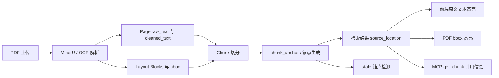

## 用户原始需求

用户希望为现有职业健康知识库新增“原文溯源”功能，目标是：检索出来的 chunk 可以在原文章或原 PDF 中定位。

## 产品概述

在现有 RAG 检索结果上增加可点击、可高亮、可解释的溯源信息。用户从搜索结果点击“查看原文”后，不仅能跳到文档页码，还能看到命中的具体文本片段、表格行或公式块位置。

## 核心功能

- 检索结果返回文档、版本、页码、chunk、matched_chunk_id 等溯源字段。
- 点击检索结果后打开原文定位视图，高亮命中片段。
- 支持页码级、文本级、PDF bbox 级、表格行级、公式块级四层定位。
- 父子块检索时，优先定位真实命中的子块，而不是展开后的父块。
- 锚点生成在入库阶段完成，检索时只读取锚点，避免在线重复匹配。
- 无法精确匹配时，自动降级为页码级定位并标记原因。
- 管理端展示引用信息、匹配方法、置信度和过期状态。

## 范围与非目标

- 基于当前 FastAPI、React、PostgreSQL、Qdrant、Celery 架构增量扩展，不重写检索系统。
- 不依赖 LLM 实时判断位置，定位过程以确定性匹配和结构化锚点为主。
- 第一阶段优先实现文本级定位，不强制一开始完成 PDF.js 坐标高亮。
- 不继续沿用脱敏语义，对外文本统一保持标准原文。

## 技术栈

- 后端：Python 3.12、FastAPI、SQLAlchemy、Alembic、Pydantic、Celery、Redis
- 数据与检索：PostgreSQL、Qdrant、BM25、语义检索、RRF 混合检索
- 文档解析：MinerU、OCR、PDF 文本层、表格 HTML、公式 LaTeX
- 前端：React 19、TypeScript、Vite、自定义 UI 组件
- 测试：pytest、Vitest、TypeScript 编译、OpenAPI 契约测试
- 第二阶段可选：pdf.js 或 react-pdf 用于 PDF 页面与 bbox 高亮

## 实现策略

新增一层“原文锚点层”，把 chunk 与页面文本、布局框、表格行和公式块建立稳定映射。

核心策略：

1. 入库解析时生成锚点，检索时只读取锚点。
2. 文本定位基于 Page.cleaned_text 的 offset，因为前端页面预览使用该文本。
3. PDF 坐标定位使用归一化 bbox，坐标范围 0 到 1000。
4. 父子块检索以 matched_chunk_id 为真实命中块，锚点绑定 matched_chunk_id。
5. 锚点绑定 version_id 和 pipeline_revision，避免文档重处理后旧锚点错位。
6. 锚点带 content_hash 和 quote_hash，用于检测人工编辑后的 stale 状态。
7. 所有新增字段保持向后兼容，旧检索结果自动降级为页码级链接。

## 性能与可靠性

- 锚点生成复杂度主要在入库阶段，不在检索热路径。
- 匹配按 document、version、page 分组，避免全库扫描。
- 精确匹配失败后才进入归一化匹配和局部窗口模糊匹配。
- 模糊匹配限制在单页文本窗口内，避免 O(chunk 数乘全库页数)。
- 为 chunk_id、quote_hash、version_id、pipeline_revision、page_number 建立索引。
- 批量回填时分批提交并限制单批处理数量，避免长事务和连接占用。
- 日志记录 anchor_type、match_method、confidence，不记录完整原文和敏感信息。

## 架构设计



## 数据模型设计

### 新增 chunk_anchors

字段：

- id、chunk_id、version_id、pipeline_revision、page_number
- start_offset、end_offset、quote、quote_hash
- bbox、box_ids、page_width、page_height
- table_id、row_start、row_end
- formula_block_id
- anchor_type、match_method、confidence、status
- created_at、updated_at

anchor_type 枚举：

- text
- table_row
- formula
- block
- page_only

match_method 枚举：

- exact
- normalized_exact
- fuzzy
- table_index
- formula_block
- page_fallback

索引：

- chunk_id
- version_id + pipeline_revision + page_number
- quote_hash
- status

### 新增 page_layout_boxes

第二阶段启用，字段：

- id、page_id、version_id、pipeline_revision、page_number
- block_id、box_type、bbox、text、text_hash
- reading_order、parent_box_id
- created_at

box_type 枚举：

- text
- table
- table_row
- table_cell
- formula
- image
- line
- span

bbox 格式：

- [x0, y0, x1, y1]
- 归一化坐标，范围 0 到 1000

## 锚点生成算法

按优先级执行：

1. exact：chunk 文本在 page.cleaned_text 中精确匹配，confidence 为 1.0。
2. normalized_exact：去除空白、统一标点后匹配，confidence 为 0.95。
3. fuzzy：在单页窗口内使用 SequenceMatcher 或 rapidfuzz，ratio 大于等于 0.85 才接受，confidence 为 0.7 到 0.9。
4. table_index：使用 table_id、row_start、row_end 定位表格行，confidence 为 1.0。
5. formula_block：使用公式块的 hash 或 block id 定位，confidence 为 1.0。
6. page_fallback：全部失败时只保留页码，confidence 为 0。

stale 判断：

- chunk.content_hash 与 anchor.content_hash 不一致时标记 stale。
- chunk.is_edited 为 true 且未重新生成锚点时标记 stale。
- version_id 或 pipeline_revision 不匹配时忽略旧锚点。

## API 设计

### 扩展 SearchResult

新增字段：

- source_location
- document_id
- version_id
- pipeline_revision
- primary_chunk_id
- primary_anchor
- anchors
- stale
- fallback_reason

返回示例：

```
{
  "chunk_id": "父块ID",
  "matched_chunk_id": "子块ID",
  "source_location": {
    "document_id": "...",
    "version_id": "...",
    "pipeline_revision": "...",
    "primary_chunk_id": "子块ID",
    "primary_anchor": {
      "page_number": 21,
      "start_offset": 382,
      "end_offset": 476,
      "quote": "苯 PC-TWA 6 mg/m³",
      "confidence": 0.98,
      "method": "normalized_exact",
      "anchor_type": "text"
    },
    "anchors": [],
    "stale": false,
    "fallback_reason": null
  }
}
```

### 扩展页面接口

修改：

```text
GET /api/v1/documents/{document_id}/pages/{page_number}
```

新增参数：

- chunk_id
- include_anchors

响应新增：

```
{
  "highlights": [
    {
      "chunk_id": "...",
      "start_offset": 382,
      "end_offset": 476,
      "quote": "苯 PC-TWA 6 mg/m³",
      "confidence": 0.98,
      "anchor_type": "text",
      "stale": false
    }
  ]
}
```

### 新增 chunk 锚点接口

```text
GET /api/v1/chunks/{chunk_id}/anchors
```

### 新增原文 PDF 接口

```text
GET /api/v1/documents/{document_id}/source
```

要求：

- 必须鉴权
- 不返回对象存储路径
- 按当前登录态判断是否允许访问原始文件

### MCP 契约

- search_knowledge 结果增加 source_location。
- get_chunk 返回 quote、source_location、page、bbox 可用状态。
- citation_rule 继续要求引用文档名和页码。
- get_chunk 优先接受 matched_chunk_id 对应的实际锚点。

## 目录结构

项目根目录为 d:/职业健康知识库。

```text
backend/
├── alembic/
│   └── versions/
│       └── 0017_source_anchors.py             # [NEW] 新增 chunk_anchors 与 page_layout_boxes 表
├── src/occupational_health/
│   ├── db/
│   │   └── models/
│   │       ├── anchoring.py                   # [NEW] ChunkAnchor、PageLayoutBox ORM 模型
│   │       └── __init__.py                    # [MODIFY] 导入并注册新模型
│   ├── api/
│   │   ├── schemas/
│   │   │   ├── search.py                      # [MODIFY] SearchResult 增加 source_location
│   │   │   └── documents.py                   # [MODIFY] 页面响应增加 highlights
│   │   └── routes/
│   │       ├── documents.py                   # [MODIFY] 页面高亮参数与原文 PDF 接口
│   │       └── chunk_review.py                # [MODIFY] chunk 接口返回锚点
│   ├── services/
│   │   ├── retrieval/
│   │   │   ├── service.py                     # [MODIFY] 检索结果填充 source_location
│   │   │   └── anchors.py                     # [NEW] 锚点生成、匹配、回填、stale 判断
│   │   ├── extraction/
│   │   │   ├── mineru.py                      # [MODIFY] 保留 layout block 与 bbox
│   │   │   └── cleaning.py                    # [MODIFY] 生成清洗 offset 映射
│   │   ├── chunking/
│   │   │   └── service.py                     # [MODIFY] chunk 输出锚点提示信息
│   │   └── documents/
│   │       └── service.py                     # [MODIFY] get_page 返回 highlights
│   ├── workers/
│   │   └── pipeline.py                        # [MODIFY] 入库时生成并保存锚点
│   └── mcp/
│       └── server.py                          # [MODIFY] 返回溯源字段
├── tests/
│   ├── unit/
│   │   ├── test_source_anchors.py             # [NEW] 锚点算法单测
│   │   └── test_mineru_layout_boxes.py        # [NEW] bbox 提取单测
│   └── contract/
│       ├── test_search.py                     # [MODIFY] 校验 source_location
│       └── test_openapi_completeness.py       # [MODIFY] 更新 operation 数量
└── docs/api/
    └── openapi.yaml                           # [MODIFY] 增加锚点、高亮、原文接口契约

frontend/
├── src/
│   ├── features/
│   │   ├── search/
│   │   │   ├── SourceLink.tsx                 # [MODIFY] 传 chunkId 与页码
│   │   │   └── SearchResults.tsx              # [MODIFY] 展示溯源入口
│   │   └── documents/
│   │       ├── PagePreview.tsx                # [MODIFY] 支持高亮 offset
│   │       └── SourceViewer.tsx               # [NEW] 原文溯源面板
│   ├── pages/
│   │   └── DocumentsPage.tsx                  # [MODIFY] 读取 query 参数并进入定位
│   ├── services/
│   │   ├── search.ts                          # [MODIFY] 增加 source_location 类型
│   │   └── documents.ts                       # [MODIFY] 页面接口参数与类型
│   └── app/
│       └── global.css                         # [MODIFY] 高亮与溯源面板样式
```

## 关键代码结构

### SourceAnchor 接口

```python
class SourceAnchor(BaseModel):
    chunk_id: str
    page_number: int
    start_offset: int | None = None
    end_offset: int | None = None
    quote: str | None = None
    quote_hash: str | None = None
    bbox: list[int] | None = None
    box_ids: list[str] = []
    table_id: str | None = None
    row_start: int | None = None
    row_end: int | None = None
    anchor_type: str
    match_method: str
    confidence: float
    status: str
```

### SourceLocation 接口

```python
class SourceLocation(BaseModel):
    document_id: str
    version_id: str
    pipeline_revision: str
    primary_chunk_id: str
    primary_anchor: SourceAnchor | None = None
    anchors: list[SourceAnchor] = []
    stale: bool = False
    fallback_reason: str | None = None
```

## 分阶段实施

### 阶段一：文本级定位

- 新增 chunk_anchors 表。
- 生成 exact、normalized_exact、fuzzy、page_fallback 锚点。
- 检索结果返回 source_location。
- 页面接口返回 highlights。
- 前端文本高亮和滚动定位。
- 批量回填已有 chunk。
- 不引入 PDF.js。

### 阶段二：PDF bbox 定位

- MinerU 解析保留 block、line、span bbox。
- 新增 page_layout_boxes 表。
- 生成 bbox 锚点。
- 新增鉴权后的原文 PDF 接口。
- 前端接入 PDF.js 并绘制高亮框。

### 阶段三：表格与公式精确定位

- 表格行、单元格 bbox。
- 公式 block id 与 LaTeX hash。
- get_chunk 返回结构化定位。
- 前端支持表格行高亮和公式块高亮。

## 测试策略

- 单测：
- 精确匹配
- 归一化匹配
- 模糊匹配阈值
- 表格行锚点
- stale 判断
- parent child 使用 matched_chunk_id
- 契约测试：
- SearchResult 包含 source_location
- 页面接口包含 highlights
- OpenAPI operation 数量更新
- 前端测试：
- SourceLink 传 chunkId
- 高亮渲染
- query 参数解析
- fallback 文案
- 集成验收：
- 搜索“苯 PC-TWA”，点击后跳到正确页面并高亮命中句。
- 搜索表格内容，命中表格时定位到表格行。
- 搜索公式内容，命中公式时显示公式块引用。
- 人工编辑 chunk 后，锚点显示 stale。
- 文档重处理后，旧 revision 锚点不串用。

## 实施注意事项

- 保持现有 page_start、page_end、page_offsets 不变，新增字段只做增量扩展。
- 不把复杂定位结构继续塞进 page_offsets。
- 检索结果里 chunk_id 可能仍是父块，定位必须使用 matched_chunk_id。
- 页面文本高亮基于 cleaned_text，PDF 高亮基于 layout boxes，两套 offset 不混用。
- 原文 PDF 接口必须鉴权，不能暴露对象存储路径。
- 日志只记录锚点状态和置信度，不记录完整原文。
- 默认无锚点时仍保留现有页码级链接，避免影响旧数据。

## 原文溯源界面设计

新增“原文溯源面板”，从检索结果点击进入。面板分为引用信息区、页面文本区、原文 PDF 区和状态提示区。第一阶段以文本高亮为主，第二阶段接入 PDF bbox 覆盖层。

## 页面与区块

- 检索结果入口：每条结果保留“查看原文第 N 页”入口，并携带 matched_chunk_id。
- 引用信息卡：展示文档名、标准号、版本号、页码、生命周期状态、匹配方法和置信度。
- 页面文本区：显示 Page.cleaned_text，命中片段用高亮背景标记，自动滚动到命中位置。
- 原文 PDF 区：第二阶段使用 PDF.js 展示 PDF，命中 bbox 使用半透明框覆盖。
- 状态提示区：当锚点 stale 或仅为页码级 fallback 时，显示明确提示。
- 表格与公式区：表格命中时高亮行或单元格，公式命中时显示公式块引用。

## 交互原则

- 一键定位，避免用户手动找页码。
- 高亮明显但不遮挡正文。
- fallback 时仍可打开页面，不阻塞用户。
- 原文内容以只读方式展示，不提供直接编辑。