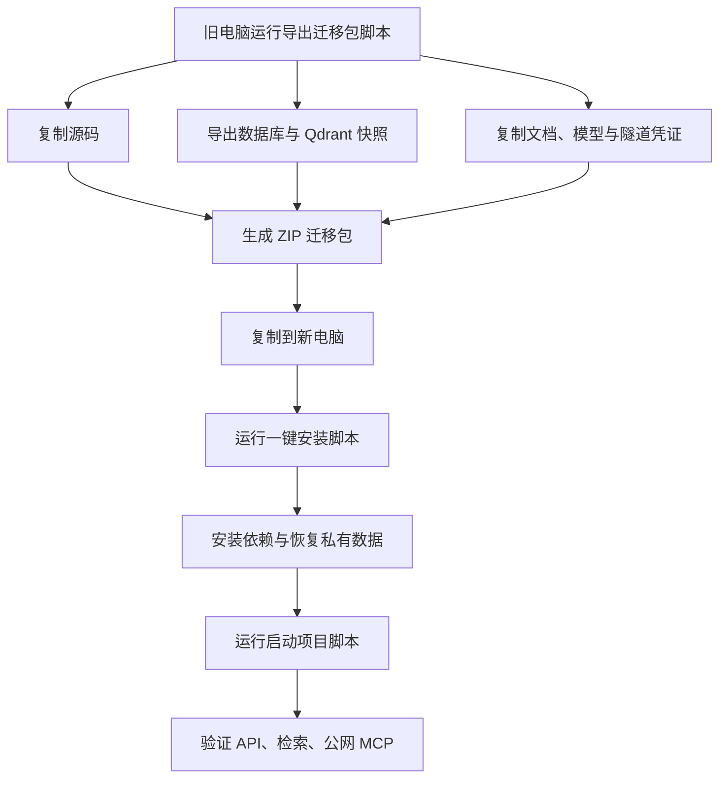

## User Requirements

### Product Overview
将当前职业健康知识库项目制作成可在另一台 Windows 10/11 电脑上运行的一键迁移包。迁移包需要包含源码、安装脚本、启动脚本、现有 60 篇文档、数据库、向量索引、模型权重、公网 MCP 配置和必要凭据，目标电脑可联网。

### Core Features
- 一键导出迁移包：从当前电脑生成完整可复制压缩包。
- 一键安装到新机：在新电脑安装依赖、恢复数据和配置。
- 保留现有知识库：文档、数据库、Qdrant 向量索引、本地模型一起迁移。
- 保留公网 MCP：复用现有 Cloudflare Tunnel 域名和凭证。
- 自动验证：检查 API、前端、向量服务、Qdrant 集合、文档数量和检索功能。
- 安全约束：真实密钥、数据库密码、隧道凭证只进入本地迁移包，不进入 Git。


## Tech Stack Selection

沿用当前项目技术栈，不引入新的运行框架：

- Windows 一键脚本：PowerShell 5.1 加 BAT 包装。
- 后端依赖：Python 3.11 到 3.13，现有 `backend/pyproject.toml`，通过 `pip freeze` 生成锁定依赖。
- 前端依赖：Node.js、npm、`package-lock.json` 优先使用 `npm ci`，否则回退 `npm install`。
- 基础设施：Docker Desktop 和 `deploy/compose.yaml`。
- 数据库导出：`pg_dump`，使用自定义格式二进制导出。
- 向量索引导出：Qdrant 快照 API，集合名 `oh_chunks_v1`。
- 文件与模型：复制 `var/data` 和 `OH_MODEL_ROOT` 指向的本地模型目录。
- 公网 MCP：Cloudflare Tunnel 配置文件和凭证 JSON。
- 压缩包：PowerShell `Compress-Archive`，输出到 `var/portable/`。

## Implementation Approach

采用“源码加私有数据快照”的一键迁移包方案，而不是把所有服务做成新 Docker 镜像。这样最贴近当前 Windows 启动方式，改动范围小，恢复后继续使用现有 `启动项目.bat`、`停止项目.bat` 和 PowerShell 看门狗。

核心策略：

1. 导出端在旧电脑执行脚本，生成带时间戳的迁移包。
2. 导出脚本复制源码时排除 `.git`、`node_modules`、`.venv`、`dist`、缓存、日志和 cookies。
3. 导出脚本把真实 `.env`、数据库 dump、Qdrant 快照、存储文件、模型权重和隧道凭证放入 `private/`。
4. 安装端在新电脑执行脚本，自动安装系统依赖、恢复私有文件、重建虚拟环境、构建前端、恢复数据库和向量索引。
5. 验证脚本检查服务是否可用，并自动给出失败原因。

关键取舍：

- 不直接复制 PostgreSQL 和 Qdrant 数据卷，避免运行中复制导致数据不一致。使用 `pg_dump` 和 Qdrant snapshot 更可靠。
- 不把迁移包提交到 Git，避免泄露真实密钥和凭证。
- 模型权重体积较大，导出时只用 ZIP 常规压缩，不做高耗时二次压缩。
- 公网 MCP 复用同一域名时，新旧机器不能同时启动隧道，脚本必须显式提示先停旧机。

## Implementation Notes

- 所有脚本必须使用 UTF-8 编码和 ASCII 日志文本，避免 Windows PowerShell 5.1 解析中文注释出错。
- 所有路径统一用 `Resolve-Path`、`Join-Path` 和引号处理，兼容中文目录。
- 导出脚本运行前检查 Docker、API、Qdrant、embedding、`.env`、模型目录和隧道配置是否存在。
- 数据库 dump 和 Qdrant snapshot 使用二进制安全方式下载，避免 PowerShell 文本重定向破坏快照。
- 安装脚本应支持重复执行：已存在的虚拟环境、前端依赖、数据库和集合需要提示或跳过。
- `.env` 恢复时必须重写新机绝对路径：`OH_MODEL_ROOT`、`OH_STORAGE_ROOT`、Cloudflare 凭证路径。
- 日志写入 `var/log/portable-export.log`、`var/log/portable-install.log`，禁止输出密钥、Token、密码和完整凭证内容。
- 保持现有运行脚本职责不变，新脚本只调用现有 `启动项目.bat`，不重写服务启动逻辑。

## Architecture Design



## Directory Structure

### Summary
新增 `deploy/portable/` 作为迁移工具目录，并补充 README 与忽略规则。现有后端、前端、业务服务代码不作为本次主要改动对象。

```text
d:/职业健康知识库/
├── deploy/
│   └── portable/
│       ├── 导出迁移包.ps1
│       │   # [NEW] 旧电脑执行。检查运行环境，复制源码，导出 pg_dump 与 Qdrant 快照，
│       │   #       复制 var/data、模型权重、真实 .env 和 Cloudflare 凭证，写 manifest.json，
│       │   #       最终生成 var/portable/职业健康知识库-迁移包-时间戳.zip。
│       ├── 导出迁移包.bat
│       │   # [NEW] 双击入口，调用 导出迁移包.ps1，设置 ExecutionPolicy Bypass。
│       ├── 安装到新电脑.ps1
│       │   # [NEW] 新电脑执行。检查 winget、Docker Desktop、Python、Node、cloudflared，
│       │   #       恢复源码和私有数据，创建 venv，安装依赖，构建前端，恢复数据库和快照。
│       ├── 一键安装.bat
│       │   # [NEW] 迁移包根目录入口，调用 安装到新电脑.ps1。
│       ├── 验证迁移结果.ps1
│       │   # [NEW] 检查 Docker、API docs、health、前端根路径、embedding、Qdrant 集合，
│       │   #       登录、文档数量、任务列表、导出、检索 smoke test 和公网 MCP 匿名访问。
│       └── 迁移说明.md
│           # [NEW] 迁移步骤、前置条件、注意事项、目录说明和故障排查。
├── README.md
│   # [MODIFY] 增加“迁移到另一台 Windows 电脑”章节，说明一键导出、复制、安装和验证流程。
├── .gitignore
│   # [MODIFY] 忽略 var/portable/、迁移 ZIP 和临时导出文件，防止私有包进入 Git。
├── 启动公网访问.bat
│   # [MODIFY] 优先使用 var/cloudflared/config.yml，失败时回退 deploy/cloudflared/config.yml。
└── deploy/scripts/supervise.ps1
    # [MODIFY/VERIFY] 保持纯 ASCII 内容、日志轮转容错、隧道配置优先读取本地私有路径。
```

### Generated Package Layout

```text
职业健康知识库-迁移包-YYYYMMDD-HHMM/
├── 一键安装.bat
├── README-迁移说明.md
├── manifest.json
├── requirements.lock.txt
├── backend/
├── frontend/
├── deploy/
├── 启动项目.bat
├── 停止项目.bat
├── 安装GPU向量化.bat
├── private/
│   ├── backend.env
│   ├── deploy.env
│   ├── cloudflared/
│   │   ├── config.yml
│   │   └── <tunnel-id>.json
│   ├── db/
│   │   └── occupational_health.dump
│   ├── qdrant/
│   │   └── oh_chunks_v1.snapshot
│   ├── data/
│   └── models/
│       └── Qwen3-Embedding-0.6B/
└── tools/
    ├── 安装到新电脑.ps1
    └── 验证迁移结果.ps1
```

## Key Code Structures

`manifest.json` 建议作为导出与安装之间的契约：

```json
{
  "schema_version": 1,
  "created_at": "ISO-8601",
  "source_root": "absolute path",
  "python": {
    "version": "3.12.x",
    "requirements_lock": "requirements.lock.txt"
  },
  "frontend": {
    "node": "20.x",
    "has_package_lock": true
  },
  "database": {
    "name": "occupational_health",
    "dump": "private/db/occupational_health.dump"
  },
  "qdrant": {
    "collection": "oh_chunks_v1",
    "snapshot": "private/qdrant/oh_chunks_v1.snapshot"
  },
  "private": {
    "backend_env": "private/backend.env",
    "deploy_env": "private/deploy.env",
    "tunnel_config": "private/cloudflared/config.yml",
    "tunnel_credentials": "private/cloudflared/<tunnel-id>.json"
  },
  "paths": {
    "storage": "var/data",
    "models": "private/models"
  },
  "checks": {
    "expected_document_count": 60
  }
}
```


## SubAgent

- **code-explorer**
  - Purpose: 复核迁移相关路径、环境变量、模型目录、隧道配置、Qdrant 集合和现有启动脚本调用关系。
  - Expected outcome: 给出迁移脚本需要的准确路径清单、潜在编码或路径风险，并确认不会覆盖业务代码和现有运行脚本职责。
